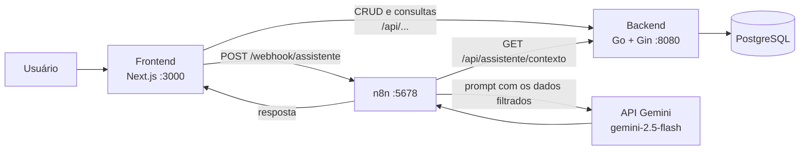

# Restomod-Core

Sistema de gestão para oficinas automotivas focadas em **Restomod** (restauração com
modificação de performance). Ele cadastra clientes, veículos, oficinas, mecânicos, peças e
fornecedores, controla projetos e serviços e funciona como um **diário de bordo** de cada
carro: o que foi trocado, por quem, com quais peças, quanto custou e quanto de potência o
carro ganhou. Tem ainda um dashboard com consultas analíticas e um assistente de IA (Gemini,
via n8n) que responde perguntas usando os dados do banco.

## Por que eu fiz isso

Num projeto de Restomod, o carro não passa só por manutenção: ele recebe um motor de outro
veículo, troca de câmbio, freio, suspensão, e cada adaptação tem custo de peça e de mão de
obra. Se tudo isso fica misturado com as revisões comuns, não dá para saber quanto custou um
upgrade nem comparar o carro antes e depois.

Então modelei o banco em torno disso. O veículo guarda a potência e o torque de fábrica
(WHP e kgfm originais), o **Upgrade Restomod** registra o sistema alterado, o veículo doador e
o resultado final no dinamômetro, e os serviços podem ficar ligados a um upgrade específico.
Assim o custo de cada modificação fica separado das manutenções de rotina, e o histórico do
projeto vira uma linha do tempo do carro.

## Como funciona



### Backend

API REST em Go com Gin e GORM. Cada entidade tem as rotas de listar, buscar, criar,
atualizar e excluir em `/api/<entidade>`. Ao subir, o backend roda o `AutoMigrate` do GORM
e cria as tabelas que não existirem.

Além do CRUD:

| Rota | O que faz |
|---|---|
| `GET /api/dashboard/servicos-por-oficina` | Quantidade e valor total de serviços por oficina |
| `GET /api/dashboard/horas-por-mecanico` | Serviços e horas realizadas por mecânico |
| `GET /api/dashboard/pecas-utilizadas` | Peças mais usadas e valor movimentado |
| `GET /api/assistente/contexto` | Junta todas as tabelas e as três análises num JSON para o assistente |
| `POST /api/seed` | Limpa o banco e carrega dados fictícios de exemplo |
| `DELETE /api/drop` | Limpa todas as tabelas (`TRUNCATE ... RESTART IDENTITY CASCADE`) |

### Banco de dados

São 14 tabelas: `oficina`, `cliente`, `veiculo`, `projeto`, `mecanico`, `servico`, `peca`,
`fornecedor`, `upgrade_restomod`, `historico_projeto`, `inspecao` e as associativas
`realiza` (mecânico × serviço), `fornece` (fornecedor × peça) e `uso_peca` (peça × serviço,
com quantidade e valor de venda).

Algumas regras que pensei para proteger os dados:

- `uso_peca` usa `ON DELETE RESTRICT` tanto na peça quanto no serviço: não dá para apagar
  uma peça ou um serviço que já movimentou estoque.
- O serviço aponta para o upgrade com `ON DELETE SET NULL`: se o upgrade sair, o serviço e o
  custo continuam registrados.
- A exclusão segue em cascata pela cadeia cliente → veículo → projeto → serviços, histórico e
  upgrades, e as inspeções saem junto com o veículo.

As tabelas são criadas pelo próprio backend ao subir (`AutoMigrate`). O script
[`Ddl database.sql`](Ddl%20database.sql) traz a mesma estrutura em SQL puro, com essas
regras escritas, para quem quiser criar o banco direto no Postgres.

Os modelos conceitual e lógico (feitos no brModelo) estão em [`Modelagem/`](Modelagem) e
aparecem também na aba de documentação do dashboard.

### Frontend

Next.js 14 com TypeScript, Tailwind e Recharts. Há uma página por entidade, todas usando o
componente `CrudTable`, e um dashboard com duas abas: a documentação técnica (objetivo,
requisitos e os diagramas do banco) e os gráficos das três consultas. Os botões
**Carregar Banco** e **Limpar Banco** do dashboard chamam `/api/seed` e `/api/drop`.

### Assistente de IA

O workflow do n8n ([`n8n/workflows/assistente-gemini.json`](n8n/workflows/assistente-gemini.json))
recebe a pergunta da página **IA Gemini** e segue estes passos:

1. Busca o contexto completo em `/api/assistente/contexto`. Se o backend não responder,
   devolve um erro 503 avisando que o banco está indisponível.
2. Filtra o contexto pela pergunta: remove stopwords, detecta por palavras-chave quais
   entidades interessam (cliente, veículo, peça, upgrade...) e manda só os itens mais
   relevantes de cada uma, com limite de 8 a 25 por entidade. Se nenhuma categoria for
   detectada, manda todas. Isso mantém o prompt pequeno.
3. Chama o `gemini-2.5-flash` com temperatura 0,3 e um prompt que manda responder só com
   os dados enviados, em português e com valores em R$.
4. Extrai o texto e devolve para o frontend.

O `docker-compose` importa esse workflow automaticamente na primeira vez que o n8n sobe.

## Estrutura

| Caminho | Papel |
|---|---|
| `backend/main.go` | Conexão, migração das tabelas, CORS e inicialização do Gin |
| `backend/config/database.go` | Conexão com o PostgreSQL pelas variáveis `DB_*` |
| `backend/models/models.go` | Todas as entidades e relacionamentos (GORM) |
| `backend/routes/routes.go` | Registro de todas as rotas da API |
| `backend/handlers/` | Um handler por entidade, mais dashboard, assistente e seed |
| `frontend/src/app/` | Páginas do Next.js (uma por entidade, dashboard e assistente) |
| `frontend/src/components/CrudTable.tsx` | Tabela genérica de listagem, cadastro e edição |
| `frontend/src/lib/api.ts` | Cliente Axios apontando para o backend |
| `n8n/workflows/assistente-gemini.json` | Workflow do assistente de IA |
| `Ddl database.sql` | Script de criação do banco com as restrições |
| `Modelagem/` | Modelos conceitual e lógico (brModelo e imagens) |
| `docker-compose.yml` | Sobe backend, frontend e n8n |
| `.env.example` | Modelo das variáveis do banco e da chave do Gemini |

## Instalação

Precisa de Docker com Docker Compose, de um PostgreSQL e de uma chave da API do Gemini
(gerada em <https://aistudio.google.com/apikey>).

O PostgreSQL **não** está no `docker-compose`: o backend se conecta a um Postgres rodando
na própria máquina (por padrão na porta 5433, banco `oficina_db`).

1. Crie o banco vazio. As tabelas o backend cria sozinho na primeira subida:

   ```powershell
   psql -h localhost -p 5433 -U postgres -c "CREATE DATABASE oficina_db"
   ```

2. Copie o `.env.example` para `.env` e preencha o usuário e a senha do Postgres e a
   `GEMINI_API_KEY`. Host, porta e nome do banco já vêm com os valores padrão. O `.env` está
   no `.gitignore`, e o `docker compose` não sobe se `DB_USER` ou `DB_PASSWORD` estiverem
   faltando.

   ```powershell
   copy .env.example .env
   ```

3. Suba tudo:

   ```powershell
   docker compose up -d --build
   ```

## Uso

| Serviço | Endereço |
|---|---|
| Frontend | <http://localhost:3000> |
| API | <http://localhost:8080/api> |
| n8n | <http://localhost:5678> |

No dashboard, clique em **Carregar Banco** para popular com os dados de exemplo (oficinas,
clientes, veículos clássicos como Opala, Maverick e Galaxie, peças, serviços e upgrades,
todos fictícios). A aba **Consultas e Análises** mostra os gráficos, e a página **IA Gemini**
aceita perguntas como "quais upgrades foram feitos no Opala?" ou "quais mecânicos trabalharam
mais horas?".

Se o assistente responder com erro, abra o n8n em <http://localhost:5678> e confira se o
workflow **Restomod - Assistente IA Gemini** está ativo.

### Rodando sem Docker

```powershell
# backend (com as variáveis DB_HOST, DB_PORT, DB_USER, DB_PASSWORD e DB_NAME definidas)
cd backend
go run .

# frontend
cd frontend
npm install
npm run dev
```

Nesse caso o n8n precisa ser instalado à parte, com o workflow importado e a variável
`GEMINI_API_KEY` definida.

## Próximos passos

- Colocar o PostgreSQL no `docker-compose`, com volume, para o projeto subir com um único
  comando.
- Proteger a API: hoje não há autenticação, o CORS aceita qualquer origem e as rotas
  `/api/seed` e `/api/drop` apagam o banco inteiro.
- Escrever testes para os handlers e para as consultas do dashboard.
